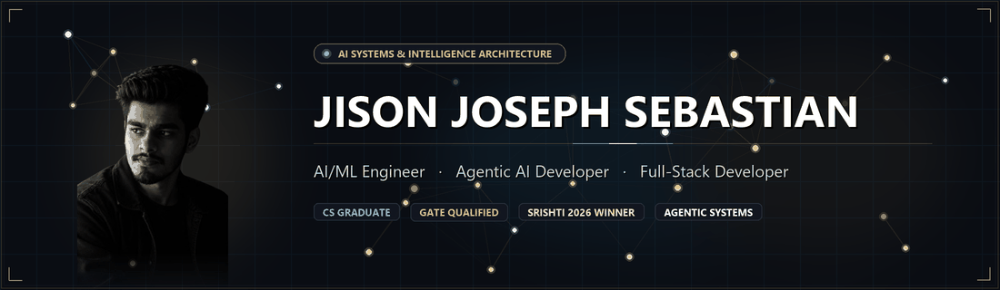

  

# Jison Joseph Sebastian

**AI/ML Engineer · Agentic AI · Full-Stack Development**  
Kannur, Kerala, India

[Portfolio](https://jisonsebastian.vercel.app/) ·
[LinkedIn](https://in.linkedin.com/in/nosij-playz44) ·
[GitHub](https://github.com/nosij-playz) ·
[Email](mailto:jisonjosephsebastian7007@gmail.com)

---

## I build practical software with AI at its core.

Computer Science graduate from Vimal Jyothi Engineering College, working across
machine learning, computer vision, LLM workflows, and web applications.

My projects combine model development with the software around it: data
pipelines, APIs, interfaces, and deployment-ready workflows.

### Areas of work

**Applied AI** — machine learning and computer vision  
**LLM systems** — retrieval, tool use, and agent workflows  
**Software engineering** — web applications, APIs, and real-time systems

---

## Selected work

### 01 — NeuroWave (CAIRS)
**Climate-aware intelligent radio system**

A team-built system that combines environmental sensing with AI-driven radio
recommendations. Recognized with the Best Project Award at SRISHTI 2026.

**Built with** · Python · TensorFlow · Environmental sensing  
[Project overview](https://jisonsebastian.vercel.app/#projects)

### 02 — Sustain_AI
**Environmental analysis with agentic AI**

An environmental analysis platform exploring agent workflows, computer vision,
and sustainability insights.

**Built with** · Python · Flask · LLMs · Computer vision  
[Source code](https://github.com/nosij-playz/Sustain_AI) ·
[Portfolio overview](https://jisonsebastian.vercel.app/#projects)

### 03 — Retrace AI
**Age-invariant facial recognition**

A deep-learning project exploring cross-age facial verification and
age-invariant face recognition.

**Built with** · PyTorch · OpenCV · CNNs  
[Source code](https://github.com/nosij-playz/Retrace-Ai) ·
[Portfolio overview](https://jisonsebastian.vercel.app/#projects)

### 04 — CureCart
**Medicine ordering and inventory management**

A web application for medicine ordering and medical inventory management.

**Built with** · Python · Flask · JavaScript · SQLite  
[Source code](https://github.com/nosij-playz/Curecart) ·
[Portfolio overview](https://jisonsebastian.vercel.app/#projects)

---

## Technical toolkit

**AI / ML**  
Python · PyTorch · TensorFlow · scikit-learn · OpenCV · NumPy · Pandas

**LLM applications**  
LangChain · Retrieval-augmented generation · Prompt engineering · Agent workflows

**Web and APIs**  
React · Node.js · Flask · FastAPI · REST APIs · WebSockets

**Data and infrastructure**  
PostgreSQL · MySQL · SQLite · MongoDB · Git · Docker · Linux

---

## Recognition

**SRISHTI 2026** — Best Project Award for NeuroWave (CAIRS)  
**GATE 2026** — Qualified in Computer Science & Information Technology  
**Industry experience** — Four internships across machine learning,
full-stack development, and data science

---

### Let’s build something useful.

Open to software engineering and AI/ML opportunities.

[Explore my portfolio](https://jisonsebastian.vercel.app/) ·
[Get in touch](https://jisonsebastian.vercel.app/#contact)

Open to software engineering and AI/ML opportunities.

[Explore my portfolio](https://jisonsebastian.vercel.app/) ·
[Get in touch](https://jisonsebastian.vercel.app/#contact)

