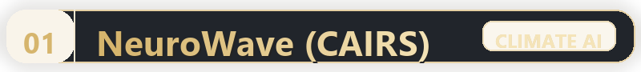
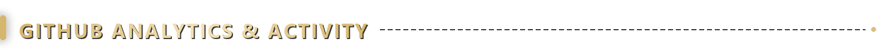

  

  <!-- Typing SVG Subtitle -->
  

  📍 <b>Kannur, Kerala, India</b>
  &nbsp;·&nbsp;
  🌐 <a href="https://jisonsebastian.vercel.app/"><b>Portfolio</b></a>
  &nbsp;·&nbsp;
  💼 <a href="https://in.linkedin.com/in/nosij-playz44"><b>LinkedIn</b></a>
  &nbsp;·&nbsp;
  💻 <a href="https://github.com/nosij-playz"><b>GitHub</b></a>
  &nbsp;·&nbsp;
  ✉️ <a href="mailto:jisonjosephsebastian7007@gmail.com"><b>Email</b></a>

---

  

Computer Science graduate from **Vimal Jyothi Engineering College**, specializing in **Applied Machine Learning**, **Computer Vision**, and **Autonomous Agentic Workflows**.

My engineering bridges **research-grade model architectures** with **scalable production systems**: robust data pipelines, low-latency APIs, and deployment-ready software.

- 🧠 **Applied AI & Computer Vision** — Engineering **deep learning backbones**, **CNN architectures**, **cross-age biometric verification**, and **climate-aware predictive models**.
- ⚡ **LLM Systems & Agent Workflows** — Developing **autonomous multi-agent pipelines**, **Retrieval-Augmented Generation (RAG)**, tool use, and **LLM evaluation benchmarks**.
- 🛠️ **Full-Stack Engineering** — Architecting **resilient microservices**, **high-throughput REST APIs**, **real-time WebSockets**, and modern web applications.

---

  

<!-- 2x2 Project Showcase Grid -->
<table width="100%">
  <tr>
    <!-- 01: NeuroWave (CAIRS) -->
    <td width="50%" valign="top">
      

        
          
        
<b>Climate-Aware Intelligent Radio System</b> 
        🏆 <b><i>Winner of Best Project Award at SRISHTI 2026</i></b>

        
An intelligent telemetry & deep learning architecture designed to <b>dynamically adapt radio transmission frequencies and modulation</b> in response to real-time <b>environmental atmospheric degradation</b> and severe weather telemetry.

        

          
          
          
        

        

          
        

      

    </td>
    <!-- 02: Sustain_AI -->
    <td width="50%" valign="top">
      

        
          
        
<b>Environmental Analysis & Multi-Agent Intelligence</b> 
        🌱 <i>Autonomous Climate Intelligence & Vision Audits</i>

        
An autonomous intelligence platform combining <b>computer vision classifiers</b> with <b>agentic LLM reasoning pipelines</b> to process raw sensor feeds and formulate <b>actionable sustainability audit reports</b>.

        

          
          
          
        

        

          
          &nbsp;
          
        

      

    </td>
  </tr>
  <tr>
    <!-- 03: Retrace AI -->
    <td width="50%" valign="top">
      

        
          
        
<b>Age-Invariant Facial Recognition & Verification</b> 
        🔍 <i>Deep Learning Latent Feature Isolation</i>

        
A biometric deep learning pipeline engineered to overcome <b>cross-age facial verification degradation</b> by isolating <b>age-invariant facial landmarks</b> and high-order latent features via <b>custom CNN backbones</b>.

        

          
          
          
        

        

          
          &nbsp;
          
        

      

    </td>
    <!-- 04: CureCart -->
    <td width="50%" valign="top">
      

        
          
        
<b>Medical Inventory & Ordering Management System</b> 
        💊 <i>Full-Stack Healthcare Web Application</i>

        
An end-to-end pharmaceutical management platform featuring <b>real-time inventory stock telemetry</b>, <b>automated prescription ledger audits</b>, and <b>secure medicine purchasing checkout workflows</b>.

        

          
          
          
        

        

          
          &nbsp;
          
        

      

    </td>
  </tr>
</table>

---

  

  

| Domain | Core Technologies & Tooling |
| :--- | :--- |
| **Artificial Intelligence & Vision** | **Python**, **PyTorch**, **TensorFlow**, **OpenCV**, **scikit-learn**, NumPy, Pandas |
| **LLMs & Agentic Systems** | **LangChain**, **RAG Pipelines**, **Autonomous Agents**, **Prompt Engineering**, Tool Use |
| **Web & API Engineering** | **React**, **Node.js**, **Express**, **FastAPI**, **Flask**, RESTful APIs, WebSockets |
| **Databases & DevOps** | **PostgreSQL**, **MySQL**, **SQLite**, **MongoDB**, **Docker**, **Git**, GitHub Actions, Linux |

---

  

  
  &nbsp;
  

  

  <picture>
    <source media="(prefers-color-scheme: dark)" srcset="https://raw.githubusercontent.com/nosij-playz/nosij-playz/output/github-contribution-grid-snake-dark.svg">
    <source media="(prefers-color-scheme: light)" srcset="https://raw.githubusercontent.com/nosij-playz/nosij-playz/output/github-contribution-grid-snake.svg">
    
  </picture>

---

  

- 🏆 **Best Project Award — SRISHTI 2026**  
  *Winner of First Place Award* at the National Level Technical Project Exhibition for **NeuroWave (CAIRS)**
- 🎓 **GATE 2026 Qualified**  
  *Graduate Aptitude Test in Engineering* in **Computer Science & Information Technology (CS & IT)**
- 💼 **4 Technical Internships**  
  Hands-on industry experience covering **Machine Learning**, **Full-Stack Engineering**, and **Data Science**
- 🚀 **15+ Shipped Projects**  
  Spanning **agentic workflows**, **computer vision research**, and **production web tools**

---

  

  <h3>Let’s build something impactful together.</h3>
  
I am actively open to <b>AI/ML Engineering</b>, <b>Agentic AI</b>, and <b>Full-Stack Developer</b> opportunities.

  
  &nbsp;&nbsp;
  

